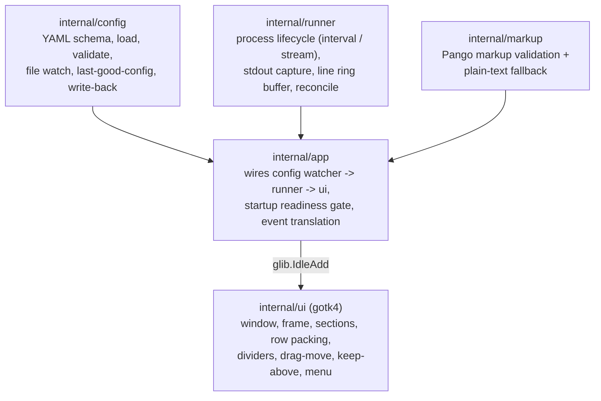

# em-data-viewer Specification

## Overview

em-data-viewer is a desktop widget application for Ubuntu / GNOME /
Wayland, built with Go and gotk4 (GTK4). It runs shell commands defined in
a YAML config file and displays their stdout in a single undecorated
window with multiple sections. The config file is watched and all changes
(styles and command definitions) are applied live without restarting.

## Architecture



`config`, `runner`, and `markup` do not import gotk4, so they stay
testable with `go test ./...`. `internal/ui` is the only GTK-touching
package; `internal/app` is the composition root that wires the others
together and posts UI updates via `glib.IdleAdd`.

### Data Flow

```
config.yaml --watch--> config --reconcile--> runner --output events--> app --IdleAdd--> ui
```

## Features

### Core: Widget Behavior

#### Config-Driven Sections

The window displays one section per command defined in the YAML config
file, in config order. Each section has a name label and an output area.

**Key Functionality:**
- Interval mode: runs the command on a configured interval and replaces
  the section's content with the full stdout of each run.
- Stream mode: starts the command once, reads stdout line by line, and
  appends lines to the section, keeping at most a configured number of
  lines (default 100, oldest dropped first).
- Output is rendered as Pango markup; invalid markup falls back to
  escaped plain text.
- Shade characters `░` `▒` `▓` in output text are drawn as `█` with 25% /
  50% / 75% foreground alpha.
- Command spawn/exit failure shows an error inside that section while
  other sections keep running.
- A config with zero sections shows an empty window (frame only).

#### Live Config Reload

The config file is watched and all changes are applied without
restarting the process.

**Key Functionality:**
- Style-only changes update the display without restarting processes.
- Adding, removing, or changing a command starts, stops, or restarts only
  the affected processes.
- An unparsable or invalid config keeps the previous good config and
  shows an error banner; a `type` value other than empty or `break` is a
  validation error.
- Config reload applies within about 1 second of saving, including
  editor save patterns (rename/replace).

#### Window Drag and Keep-Above

**Key Functionality:**
- A left-button drag started anywhere on the window (including over
  section labels, output text, or the error banner) moves the window; a
  plain click with no movement does nothing.
- Right-click opens a context menu with a "終了" (Quit) item and a
  "最前面に固定" (keep above) check item.
- `window.keep_above` (config, default `true`) keeps the widget above
  other windows. On X11/XWayland this is applied via the EWMH
  `_NET_WM_STATE_ABOVE` property; on native Wayland the menu item is
  insensitive (no native keep-above API) and the WM's own always-on-top
  shortcut is the alternative.
- Toggling the menu item applies immediately and writes the new
  `keep_above` value back to the config file, preserving the rest of the
  YAML (including comments).
- Quit terminates all child processes (SIGTERM, then SIGKILL after a
  timeout) and exits.

#### Startup Window Fit

**Key Functionality:**
- The window's first presentation is deferred until either every
  section's first data has arrived (result or error event) or a fixed
  1-second timeout elapses, whichever comes first.
- The height used at first presentation is computed from the real
  row-packed layout at the configured window width, not a degraded
  width-0 layout, so the window appears once at its fitted size instead
  of flashing oversized and later snapping to size.
- When the initial config fails to load or has zero sections, the window
  presents immediately without waiting.
- After presentation, allocation-driven refits continue to act as a
  safety net.

---

### Layout

#### Dynamic Window Height

**Key Functionality:**
- Window height follows the natural height of the banner plus all
  sections; it is not a fixed config value.
- Height re-fits at runtime as section output grows/shrinks, sections are
  added/removed on reload, or styles change.
- Height is capped at the monitor's height; content beyond the cap is
  clipped.
- `window.height` is no longer part of the config schema; a `height` key
  present in existing YAML is silently ignored. `window.width` behavior
  is unchanged.
- With zero sections, the window shows at the minimum frame height.

#### Greedy Row Packing

Sections are laid out left to right in config order and wrap to the next
row when the remaining width is insufficient, using a hand-rolled greedy
packing algorithm (`packRows`) rather than a uniform-column grid. This
layout superseded an earlier GtkFlowBox-based implementation, which
aligned children into columns stretched to the widest member.

**Key Functionality:**
- Each row holds as many sections as fit at their natural (unstretched)
  widths; no column alignment or stretching to the widest section.
- Visual order always equals config order (left to right, then top to
  bottom).
- Reflow is triggered by section rebuilds, section updates, window width
  changes, and window mapping; an unchanged row assignment does not
  rebuild widgets.
- A section wider than the available width occupies its own row; its
  output label wraps as before.
- Row/column spacing: 12px (2 units) within a row, 0 between rows.

#### Forced Row Breaks

A `- type: break` entry in the `sections` config array ends the current
row at that point, so the following section always starts a new row.

**Key Functionality:**
- Sections between breaks form segments; each segment is packed
  independently with the normal width-based greedy algorithm, then the
  resulting rows are concatenated in order.
- Leading breaks, trailing breaks, consecutive breaks, or a config of
  breaks only produce no empty rows.
- Breaks are display-only: they start no process, hold no style, and are
  excluded from duplicate-key checks.
- A break-created row boundary renders the same divider as a
  naturally-wrapped boundary.

#### Section Divider Rules

Rows and in-row sections are separated by floating 1px divider rules
instead of spacing alone.

**Key Functionality:**
- A horizontal divider (1px, `color.divider`) separates adjacent rows,
  with zero extra vertical gap and 1-unit (6px) horizontal inset from the
  row edges.
- A vertical divider (1px, `color.divider`) separates adjacent sections
  within a row, with 1 unit of space on each side and 1-unit top/bottom
  inset.
- No rule touches another rule or the window frame (no corners, T-, or
  cross-junctions).
- A single row renders no horizontal divider; a single-section row
  renders no vertical divider; zero sections render no dividers.
- The config-error banner has 1 unit (6px) of space below it before the
  sections.

---

### Output Rendering

#### Default Output Font Size

Command output text defaults to 11pt (monospace); the section label
default stays 9pt. A config override (`style.font` / `output-size`)
still takes precedence over the default.

#### Trailing Newline Stripping

All trailing newlines are stripped from section output before rendering,
across every display path (interval replace, stream append, section
error), while interior blank lines are preserved.

**Key Functionality:**
- Interval (replace) output, joined stream (append) output, and error
  messages all have trailing newlines stripped at render time; the
  stream ring buffer's stored lines are not modified.
- Output consisting only of newlines renders as an empty string (label
  only, no output line box).
- Stripping operates on raw text before Pango markup rendering.

---

### Desktop Integration / Packaging

#### App Icon

A single SVG source of truth renders hicolor theme icons and a
`.desktop` entry at build/package time.

**Key Functionality:**
- `assets/icon.svg` is the git-tracked icon source; no binary icon files
  are committed.
- `make icons` renders `em-data-viewer-{48,64,128,256}.png` from the SVG
  via `rsvg-convert`; the `dpkg` target depends on it and fails loudly if
  `rsvg-convert` is missing.
- `make dpkg` installs hicolor PNGs and the scalable SVG under
  `usr/share/icons/hicolor/`, a `.desktop` entry under
  `usr/share/applications/`, and `postinst`/`postrm` maintainer scripts
  that best-effort refresh the icon cache and desktop database.
- At startup the UI sets the top-level window's icon name to
  `em-data-viewer` so it resolves from the installed hicolor theme.

#### Icon Binary Embedding

The application icon is additionally embedded into the binary as a
GResource bundle, so it resolves in the dock/taskbar/window even when the
hicolor theme icons are not installed (e.g. running a development
binary directly).

**Key Functionality:**
- `make resources` renders icon PNGs at six sizes and compiles them with
  `glib-compile-resources` into `internal/ui/icon.gresource` (git-ignored)
  from a git-tracked XML manifest (`assets/icon.gresource.xml`).
- `make build` and `make test` depend on `resources`, so the resource
  bundle always exists before `go:embed` compiles it in.
- At UI construction, the embedded resource is registered globally and
  its base path is added to the display's icon theme resource path;
  registration failure is logged and does not crash the app.
- `make dpkg` output is unchanged in structure by this feature.

#### Application ID / .desktop Filename Match

The GTK application ID matches the shipped `.desktop` filename so the
Wayland (GNOME Shell) dock and Alt-Tab can resolve the app icon by
app_id, which GTK4/Wayland requires (X11 continues to match via
`StartupWMClass`).

**Key Functionality:**
- The application ID is `io.github.m_m_n.EmDataViewer`.
- `make dpkg` installs the desktop entry as
  `usr/share/applications/io.github.m_m_n.EmDataViewer.desktop`; the
  content is unchanged (`Icon=em-data-viewer`,
  `StartupWMClass=em-data-viewer`) and `em-data-viewer.desktop` is no
  longer shipped.
- The icon name (`em-data-viewer`), used for hicolor files, the
  GResource base path, and `SetIconName`, is unaffected.

## Configuration

Config file location: `$XDG_CONFIG_HOME/em-data-viewer/config.yaml`,
falling back to `~/.config/em-data-viewer/config.yaml`. A CLI positional
argument overrides this path.

```yaml
window:
  width: 400          # optional, default 400
  keep_above: true    # optional, default true; X11/XWayland only (Wayland: inert)
  style:               # optional; frame/background appearance
    background: "#1e1e1eee"
    border_color: "#888888"
    border_width: 1

sections:
  - name: clock        # optional display name
    command: "date '+%H:%M:%S'"   # required; run via sh -c
    mode: interval     # interval | stream (required)
    interval: 1s       # required when mode: interval (Go duration string)
    max_lines: 100     # stream only; optional, default 100
    style:             # optional
      font: "monospace 12"
      color: "#ffffff"

  - type: break        # optional; forces a row break at this position
```

`window.height` is not a config field; a `height` key present in YAML is
silently ignored. Config parse or validation errors keep the last good
config and show an error banner instead of applying the change.

## Dependencies

**External Dependencies:**
- `github.com/diamondburned/gotk4/pkg` — GTK4 bindings (UI)
- `gopkg.in/yaml.v3` — config parsing and comment-preserving write-back
- `github.com/fsnotify/fsnotify` — config file watching
- `github.com/jezek/xgb` — pure-Go X11 client for EWMH keep-above
  messages

**Build-time tools:**
- `rsvg-convert` (librsvg) — renders PNG icons from `assets/icon.svg`
- `glib-compile-resources` (libglib2.0) — compiles the embedded icon
  GResource bundle

**Runtime package dependency:** `libgtk-4-1` (declared in the deb
`control` file)

## Technical Notes

- `internal/config`, `internal/runner`, and `internal/markup` must not
  import gotk4, so their logic (config parsing, section reconciliation,
  markup validation/fallback, stream line-buffering, row-packing math,
  startup readiness gating) stays testable with `go test ./...` without a
  display.
- `internal/ui` is the only GTK-touching package; UI updates from
  background events are always posted via `glib.IdleAdd`, never called
  directly from goroutines.
- GTK's GPU renderers (vulkan/ngl) drop thin glyph strokes at small sizes
  on some setups; `cmd/em-data-viewer/main.go` defaults `GSK_RENDERER` to
  `cairo` unless the environment already sets it.
- Build artifacts (`build/`, `internal/ui/icon.gresource`) are
  git-ignored; no binary files are committed. `assets/icon.svg` is the
  single git-tracked icon source.
- Packaging: `make dpkg` builds a `.deb` containing the binary, hicolor
  icons, the `.desktop` entry, `config.yaml.example`, and
  `postinst`/`postrm` maintainer scripts.
