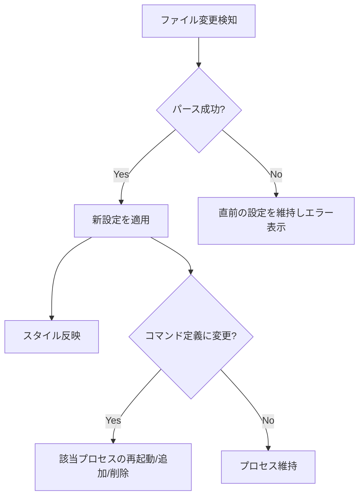

# process-output-widget - 要件定義書

## 1. 概要

### 1.1 背景
デスクトップ上にコマンドの出力を常時表示するウィジェットが欲しい。

### 1.2 目的
設定ファイルで定義したコマンドの標準出力をデスクトップウィジェットとして表示する GUI アプリケーション（data-viewer）を新規開発する。

### 1.3 スコープ
- Go + gotk4 (GTK4) によるデスクトップウィジェットアプリの新規実装
- 対象プラットフォーム: Ubuntu / GNOME / Wayland

## 2. ビジネス要件

### 2.1 対象ユーザー
| ユーザータイプ | 説明 |
|----------------|------|
| デスクトップユーザー | 自分の Linux デスクトップにシステム情報等を常時表示したい利用者 |

### 2.2 期待される効果
- 任意のコマンド出力をデスクトップに常時表示できる
- 設定ファイル編集だけで表示内容・見た目を即座に変更できる

## 3. ユースケース

### 3.1 ユースケース一覧
| ID | ユースケース名 | アクター | 優先度 |
|----|----------------|----------|--------|
| UC01 | ウィジェットを起動して出力を眺める | ユーザー | 高 |
| UC02 | 設定ファイルを編集して即座に反映させる | ユーザー | 高 |
| UC03 | ウィジェットをドラッグで移動する | ユーザー | 高 |
| UC04 | 右クリックメニューから終了する | ユーザー | 中 |

### 3.2 ユースケース詳細

#### UC01: ウィジェットを起動して出力を眺める

**アクター**: ユーザー

**事前条件**:
- 設定ファイルが存在する（`~/.config/data-viewer/config.yaml` または CLI 引数で指定）

**基本フロー**:
1. ユーザーが `data-viewer` を起動する
2. アプリが設定ファイルを読み込む
3. タイトルバーなし・枠のみのウィンドウが表示される
4. 設定に定義された各コマンドがセクションとして縦に並び、出力が表示される
5. 定期実行コマンドは間隔ごとに出力全体を置き換え、ストリームコマンドは出力を追記する

**代替フロー**:
- 設定ファイルが存在しない/パース不能 → エラーを表示して起動（表示内容は空 + エラー）
- コマンドが失敗 → 該当セクションにエラー表示、他セクションは継続

**事後条件**:
- ウィジェットがデスクトップに表示され続ける

#### UC02: 設定ファイルを編集して即座に反映させる

**アクター**: ユーザー

**基本フロー**:
1. アプリ起動中にユーザーが設定ファイルを編集・保存する
2. アプリがファイル変更を検知する
3. スタイル（色・フォント等）とコマンド定義（追加・削除・変更）の両方が再読み込みされ、表示に反映される
4. コマンド定義が変わったセクションは該当プロセスを再起動する

**代替フロー**:
- 編集後の設定がパース不能 → 直前の有効な設定を維持し、エラーを表示する

#### UC03: ウィジェットをドラッグで移動する

**基本フロー**:
1. ユーザーがウィンドウ（枠・背景部分）をドラッグする
2. ウィンドウが移動する

#### UC04: 右クリックメニューから終了する

**基本フロー**:
1. ユーザーがウィンドウ上で右クリックする
2. コンテキストメニューが表示される
3. 「終了」を選択するとアプリが終了し、起動中の子プロセスも停止する

## 4. 機能要件

### 4.1 機能一覧
| ID | 機能名 | 説明 | 優先度 |
|----|--------|------|--------|
| F01 | 自前装飾ウィンドウ | タイトルバーなし・枠のみのウィンドウ。ドラッグで移動可能 | 高 |
| F02 | 設定ファイル読み込み | YAML 設定を XDG パスから読み込み。CLI 引数でパス上書き可 | 高 |
| F03 | 設定のリアルタイム反映 | ファイル変更を監視し、スタイル・コマンド定義の全てを即時反映 | 高 |
| F04 | 定期実行コマンド | 指定間隔でコマンドを実行し、セクションの表示を出力で置き換え | 高 |
| F05 | ストリームコマンド | 常駐コマンドを 1 回起動し、出力が来るたびに追記表示 | 高 |
| F06 | Pango マークアップ描画 | 出力を Pango マークアップとして解釈し、文字色等の装飾を表示 | 高 |
| F07 | 複数セクション表示 | 1 ウィンドウ内に複数コマンドのセクションを縦に並べて表示 | 高 |
| F08 | 右クリックメニュー | 「終了」を含むコンテキストメニュー | 中 |
| F09 | エラー処理 | 設定エラー時は直前設定維持 + エラー表示。コマンドエラーはセクション内表示 | 高 |

### 4.2 機能詳細

#### F02: 設定ファイル読み込み

**入力**:
- 設定ファイルパス: デフォルト `~/.config/data-viewer/config.yaml`（`$XDG_CONFIG_HOME` 準拠）、CLI 引数で任意パスを指定可能

**設定内容**:
- ウィンドウ設定（サイズ、枠・背景などの見た目）
- セクションのリスト。各セクションは以下を持つ:
  - 実行コマンド
  - 実行モード（定期実行 / ストリーム）
  - 定期実行の場合は実行間隔
  - スタイル（色・フォント等）

#### F03: 設定のリアルタイム反映

**処理フロー**:

**エラーケース**:
| エラー | 条件 | 対応 |
|--------|------|------|
| 設定パースエラー | YAML が不正 | 直前の有効な設定を維持し、エラーを表示 |
| コマンド実行エラー | コマンドが失敗・異常終了 | 該当セクションにエラー表示、他セクションは継続 |

## 5. 非機能要件

### 5.1 パフォーマンス要件
- 設定変更の反映: 保存からおおむね 1 秒以内
- ストリーム出力の表示行数は上限を設け、メモリを無制限に消費しない

### 5.2 セキュリティ要件
- 設定ファイルに書かれたコマンドをユーザー権限で実行する（設定ファイルはユーザー自身が管理する前提）
- Pango マークアップとして不正な出力は装飾なしのプレーンテキストとして表示する

### 5.3 互換性要件
- Ubuntu / GNOME / Wayland で動作すること
- GTK4（gotk4 バインディング）を使用すること

## 6. UI/UX要件

### 6.1 画面設計要件
- タイトルバーなし（サーバーサイド装飾を使わない）、基本の枠のみの単一ウィンドウ
- ウィンドウの重ね順は通常ウィンドウとして扱う
- ウィンドウ内に複数セクションを縦に並べる
- ドラッグでウィンドウを移動できる
- 右クリックでコンテキストメニュー（終了）

## 7. データ要件

### 7.1 データ項目（設定ファイル）
| エンティティ | 項目名 | 型 | 必須 | 説明 |
|--------------|--------|-----|------|------|
| window | width / height | int | × | ウィンドウサイズ |
| window | style | map | × | 枠・背景等の見た目 |
| section | command | string | ○ | 実行するシェルコマンド |
| section | mode | enum | ○ | `interval` / `stream` |
| section | interval | duration | interval 時○ | 実行間隔 |
| section | style | map | × | セクションのスタイル |

## 8. 制約条件

### 8.1 技術的制約
- 言語: Go、GUI: gotk4 (GTK4)
- Wayland ではアプリからウィンドウ位置を絶対座標で指定できないため、移動はコンポジタ経由のドラッグ操作で実現する

## 9. 想定される課題とリスク

| 課題 | 影響度 | 対応策 |
|------|--------|--------|
| Wayland でのウィンドウ位置制御の制約 | 中 | 位置の保存・復元はスコープ外とし、ドラッグ移動のみサポート |
| ストリーム出力の大量流入 | 中 | 表示行数上限で古い行を破棄 |

## 10. 成功基準

### 10.1 受け入れ基準
- [ ] 設定ファイルに定義した複数コマンドの出力が 1 ウィンドウに表示される
- [ ] 定期実行・ストリームの両モードが動作する
- [ ] 設定ファイルの編集がアプリ再起動なしで反映される（スタイル・コマンド定義とも）
- [ ] Pango マークアップによる文字色等の装飾が表示される
- [ ] ウィンドウをドラッグで移動できる
- [ ] 右クリックメニューから終了できる
- [ ] 設定パースエラー時に直前の設定が維持される
- [ ] `go test ./...` が通る

## 11. テストシナリオ

### 11.1 テスト観点
- [ ] 正常系: 設定読み込み → 複数セクション表示 → 定期/ストリーム更新
- [ ] 異常系: 不正 YAML、存在しないコマンド、異常終了するコマンド、不正な Pango マークアップ
- [ ] 境界値: セクション 0 個の設定、巨大なストリーム出力（行数上限）
- [ ] リアルタイム反映: スタイルのみ変更 / コマンド追加・削除・変更 / 不正な設定への変更

## 12. 用語定義

| 用語 | 定義 |
|------|------|
| セクション | 1 つのコマンドとその出力表示領域の組 |
| 定期実行モード | 一定間隔でコマンドを実行し、出力全体で表示を置き換えるモード |
| ストリームモード | 常駐コマンドを 1 回起動し、出力を追記表示するモード |
| Pango マークアップ | GTK の `` ベースのテキスト装飾記法 |

## 13. 確認事項

### 13.1 確認済み事項

- [x] アプリの用途: 常駐型デスクトップウィジェット
- [x] プロセス実行方式: 定期実行・常駐ストリームの両方に対応し、設定でモードを選択
- [x] 装飾記法: Pango マークアップ
- [x] 設定フォーマット: YAML
- [x] ウィンドウの重ね順: 通常ウィンドウ（layer-shell は使わない）
- [x] 表示構成: 1 ウィンドウに複数セクション
- [x] リアルタイム反映の範囲: スタイル・コマンド定義を含む全設定
- [x] 設定ファイルの場所: XDG デフォルト + CLI 引数で上書き
- [x] 終了方法: 右クリックメニュー
- [x] エラー処理: 設定エラーは直前設定維持 + 表示、コマンドエラーはセクション内表示
- [x] テスト: go test のみ（ロジック層中心、GUI は手動確認）
- [x] design ステップ: 実施する

### 13.2 未確認・保留事項
- なし
