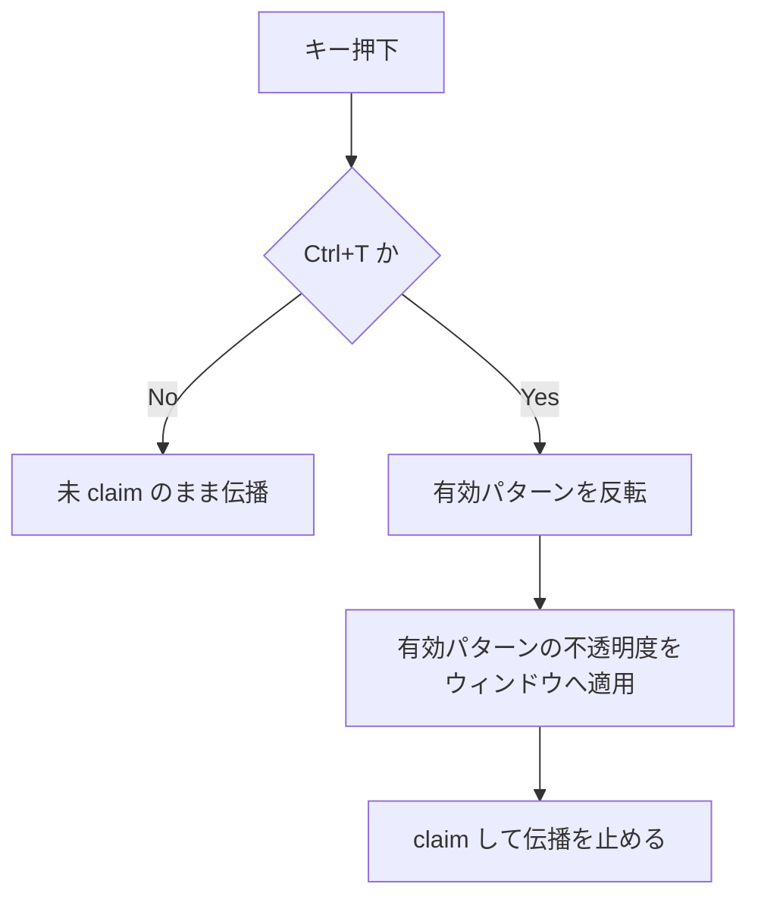
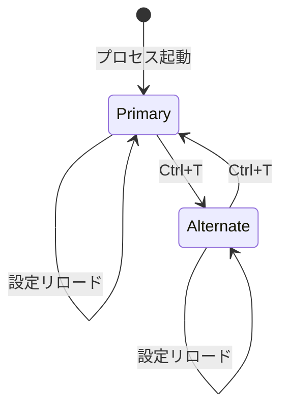

# ウィンドウ全体の透過度トグル - 要件定義書

## 1. 概要

### 1.1 背景

最前面表示（keep-above）でウィジェットを使っていると、デフォルトの透過度では
濃すぎて背後の内容が見えず邪魔になることがある。単一画面ならアクティブ/非
アクティブで濃さを切り替える手もあるが、複数画面構成ではサブモニター側は濃い
まま表示しておきたいケースがあるため、フォーカス連動ではなく明示的なキー操作で
切り替えられる必要がある。

先行タスク `window-opacity-toggle` で `Ctrl+T` によるトグルを実装済みだが、
切り替わるのがウィンドウ背景色（`background` / `background_alt`）のアルファ値
だけで、コマンド出力テキストやセクションラベル、枠線は濃いまま残る。薄くした
状態でも文字が背後の内容に重なって読みづらく、「邪魔にならない」という目的を
満たしていない。本タスクはそのリテイクにあたる。

### 1.2 目的

`Ctrl+T` で切り替わる対象を、背景色だけでなくウィンドウ全体（背景・枠線・
セクションラベル・コマンド出力テキストを含む描画結果すべて）の不透明度に
変更する。

### 1.3 スコープ

**対象**:

- ウィンドウ全体の不透明度を 2 パターン設定ファイルで指定できるようにする
- `Ctrl+T` で 2 パターンを相互にトグルする
- 先行タスクが導入した背景色のみのトグル機構（`background_alt` /
  `color.surface-alt` / `ApplyBackgroundPattern`）の撤去

**対象外**:

- フォーカス連動やモニター単位の自動切り替え
- トグル状態の永続化（プロセス再起動で初期パターンに戻る）
- キーバインドのユーザー設定化（`Ctrl+T` 固定）
- セクション単位の個別透過度指定

## 2. ビジネス要件

### 2.1 ビジネス目標

最前面固定のまま常用できるウィジェットにする。邪魔になった瞬間に 1 キーで
「見えるが視界を塞がない」状態へ退避でき、また 1 キーで戻せること。

### 2.2 対象ユーザー

| ユーザータイプ | 説明 |
|----------------|------|
| デスクトップ常用ユーザー | ウィジェットを最前面固定でデスクトップに常駐させている利用者 |
| マルチモニター利用者 | サブモニターでは濃いまま、メイン画面では薄くしたい利用者 |

### 2.3 期待される効果

- 薄くした状態で背後のウィンドウの内容が実際に読める
- 設定ファイルを編集せずに濃さを切り替えられる
- 先行実装の中途半端な挙動（背景だけ薄くなる）が解消される

## 3. ユースケース

### 3.1 ユースケース一覧

| ID | ユースケース名 | アクター | 優先度 |
|----|----------------|----------|--------|
| UC01 | 邪魔なときに薄くする | デスクトップ常用ユーザー | 高 |
| UC02 | 濃い表示に戻す | デスクトップ常用ユーザー | 高 |
| UC03 | 2 パターンの濃さを設定する | デスクトップ常用ユーザー | 高 |

### 3.2 ユースケース詳細

#### UC01: 邪魔なときに薄くする

**アクター**: デスクトップ常用ユーザー

**事前条件**:

- ウィジェットが起動しており、キーボードフォーカスを持っている
- 現在は主パターン（濃い側）が有効

**基本フロー**:

1. ユーザーが `Ctrl+T` を押す
2. ウィンドウ全体の不透明度が代替パターンの値に切り替わる
3. 背景・枠線・ラベル・コマンド出力テキストがまとめて薄くなり、背後の内容が
   透けて見える

**事後条件**:

- 代替パターンが有効な状態になる
- ウィンドウの位置・幅・高さは変化しない
- コマンドの実行やストリーム出力の蓄積は中断されない

#### UC02: 濃い表示に戻す

**アクター**: デスクトップ常用ユーザー

**事前条件**:

- 代替パターン（薄い側）が有効

**基本フロー**:

1. ユーザーが `Ctrl+T` を押す
2. ウィンドウ全体の不透明度が主パターンの値に戻る

**事後条件**:

- 主パターンが有効な状態になる

#### UC03: 2 パターンの濃さを設定する

**アクター**: デスクトップ常用ユーザー

**事前条件**:

- 設定ファイル（`config.yaml`）が存在する

**基本フロー**:

1. ユーザーが `window.style.opacity` と `window.style.opacity_alt` に値を書く
2. 設定ファイルの監視により自動リロードされる
3. 現在有効なパターンの新しい値が即座に反映される

**代替フロー**:

- どちらのキーも書かない場合は組み込みデフォルト値が使われる
- 値が数値として解釈できない、または範囲外の場合は該当キーのデフォルト値に
  フォールバックする（設定全体はエラーにしない）

**事後条件**:

- 有効パターンの区別（主 / 代替）はリロードをまたいで保持される

## 4. 機能要件

### 4.1 機能一覧

| ID | 機能名 | 説明 | 優先度 |
|----|--------|------|--------|
| F01 | ウィンドウ不透明度の 2 パターン設定 | 設定ファイルで主 / 代替の不透明度を指定する | 高 |
| F02 | `Ctrl+T` トグル | キー操作で有効パターンを反転しウィンドウ全体に適用する | 高 |
| F03 | 不正値のフォールバック | 解釈できない値・範囲外の値をデフォルトへ落とす | 高 |
| F04 | 背景色トグル機構の撤去 | 先行タスクの `background_alt` 系を取り除く | 高 |

### 4.2 機能詳細

#### F01: ウィンドウ不透明度の 2 パターン設定

**説明**: 既存の `window.style` マップに 2 つのキーを追加する。先行タスクの
`background_alt` と同じ経路（`config.Window.Style` → `ui.MergeStyle`）を通る
ため、config パッケージのスキーマ変更は不要。

**入力**:

- `window.style.opacity`: 文字列 - 主パターンの不透明度（`0.0`〜`1.0`）
- `window.style.opacity_alt`: 文字列 - 代替パターンの不透明度（`0.0`〜`1.0`）

**出力**:

- ウィンドウウィジェットに適用される不透明度（float64）

**ビジネスルール**:

- 値は不透明度（opacity）であり、1.0 が完全不透明、0.0 が完全透明
- 主パターンのデフォルトは 1.0（現行リリースと同一の見た目を維持する）
- 代替パターンのデフォルトは 0.45

**バリデーション**:

| 項目 | ルール | 挙動 |
|------|--------|------|
| `opacity` / `opacity_alt` | 十進小数として解釈できること | 解釈不能なら該当キーのデフォルト値 |
| `opacity` / `opacity_alt` | 0.0 以上 1.0 以下 | 範囲外なら該当キーのデフォルト値 |

#### F02: `Ctrl+T` トグル

**説明**: 先行タスクが実装済みのキーコントローラ（capture フェーズ、
`Ctrl+T` のみ claim）をそのまま流用し、切り替え対象を背景色から
ウィンドウ全体の不透明度へ差し替える。

**処理フロー**:

**ビジネスルール**:

- プロセス起動時は必ず主パターンが有効
- 有効パターンは設定ファイルに書き戻さない（プロセスローカル状態）
- `Ctrl+Alt+T` や `Ctrl+Super+T` は claim しない（先行実装の挙動を維持）

#### F03: 不正値のフォールバック

**説明**: 不透明度の解釈は純粋関数として実装し、GTK に依存せずテストできる
ようにする。設定エラーバナーは出さず、静かにデフォルトへ落とす。

**エラーケース**:

| エラー | 条件 | 対応 |
|--------|------|------|
| 解釈不能 | `"abc"` など数値でない | 該当キーのデフォルト値を使う |
| 範囲外 | `-0.1` / `1.5` | 該当キーのデフォルト値を使う |
| キー欠落 | 設定に書かれていない | 該当キーのデフォルト値を使う |

#### F04: 背景色トグル機構の撤去

**説明**: 先行タスクが追加した以下を取り除く。

- `internal/ui/style.go` の `WindowStyleDefaults["background_alt"]` と
  `ApplyBackgroundPattern`
- `design-system/tokens.yaml` の `color.surface-alt`
- `config.yaml.example` の `background_alt` の記述
- 上記に紐づくテスト

**ビジネスルール**:

- `background`（主背景色、`#1e1e1eee`）は現状のまま維持する
- 既存の設定ファイルに `background_alt` が残っていても、未知キーは
  `MergeStyle` が無視するため読み込みは壊れない

## 5. 非機能要件

### 5.1 パフォーマンス要件

- トグルは次フレームで反映され、ウィンドウの再生成・リサイズ・再レイアウト・
  内容の再取得を伴わない

### 5.2 セキュリティ要件

- 該当なし（ローカル設定ファイルの読み取りのみ。外部入力・認証・永続化なし）

### 5.4 保守性要件

- 不透明度の解釈と有効パターン選択は GTK 非依存の純粋関数とし、
  `go test ./...` で検証可能にする
- `config` パッケージは引き続き gotk4 系パッケージを import しない

### 5.5 互換性要件

- `opacity` / `opacity_alt` を書いていない既存設定ファイルはそのまま動作し、
  起動直後の見た目は現行リリースと同一
- `background_alt` を書いている設定ファイルもエラーにならない（無視される）

## 6. UI/UX要件

### 6.1 画面設計要件

新規画面・新規コンポーネントは追加しない。既存のウィジェットウィンドウの
不透明度が変化するのみ。

### 6.2 状態遷移

## 7. データ要件

永続データなし。有効パターンはプロセスローカルなインメモリ状態。

### 7.2 データ項目

| エンティティ | 項目名 | 型 | 必須 | 説明 |
|--------------|--------|-----|------|------|
| window.style | opacity | string | × | 主パターンの不透明度（既定 `"1.0"`） |
| window.style | opacity_alt | string | × | 代替パターンの不透明度（既定 `"0.45"`） |
| frame | 有効パターン | bool | ○ | 代替パターンが有効なら true（起動時 false） |

## 8. 外部連携

なし。

## 9. 制約条件

### 9.1 技術的制約

- Go + gotk4（GTK4）、Ubuntu / GNOME / Wayland 環境
- ウィンドウ全体の不透明度は GTK ウィジェットの opacity で表現する
  （CSS の `background-color` のアルファ値では文字が薄くならないため）
- 実効的な透過はコンポジタに依存する。コンポジタが合成を行わない環境では
  透過が効かない可能性がある

### 9.2 ビジネス上の制約

- キーバインドは `Ctrl+T` 固定（タスクの受け入れ条件）

## 10. 想定される課題とリスク

### 10.1 技術的課題

| 課題 | 影響度 | 対応策 |
|------|--------|--------|
| ウィジェット opacity と背景色アルファの二重適用で薄くなりすぎる | 中 | 主パターンのデフォルトを 1.0 とし、既定の見た目を現行と一致させる |
| GTK 依存部分がユニットテストできない | 中 | 値の解釈と有効パターン選択を純粋関数に切り出す |
| ネイティブ Wayland でコンポジタが opacity を無視する | 低 | 検証フェーズで実機確認し、結果を記録する |

## 11. 成功基準

### 11.1 受け入れ基準

- [ ] 設定ファイルで不透明度を 2 パターン設定できる
- [ ] `Ctrl+T` で 2 パターンをトグルできる
- [ ] 薄くしたとき、背景色だけでなくテキスト・枠線を含む全体が薄くなる
- [ ] `opacity` / `opacity_alt` を書いていない設定ファイルが従来どおり動作し、
      起動直後の見た目が現行リリースと同一
- [ ] `background_alt` 系の実装・トークン・ドキュメント・テストが撤去されている
- [ ] `make test` が通る

## 12. テストシナリオ

### 12.1 テスト観点

- [ ] 正常系: 主 → 代替 → 主 のトグルで有効パターンが反転する
- [ ] 正常系: 設定した `opacity` / `opacity_alt` の値が適用される
- [ ] 正常系: 設定リロード後も有効パターンの区別が保持される
- [ ] 異常系: 解釈不能な値・範囲外の値がデフォルトへフォールバックする
- [ ] 境界値: `0.0` と `1.0` は有効値として受理される
- [ ] 回帰: `Ctrl+Alt+T` / `Ctrl+Super+T` / その他キーは claim されない
- [ ] 回帰: `background_alt` を含む設定ファイルが読み込みエラーにならない

## 13. 用語定義

| 用語 | 定義 |
|------|------|
| 主パターン | 通常時の濃い表示。起動時に有効 |
| 代替パターン | `Ctrl+T` で切り替わる薄い表示 |
| 不透明度 (opacity) | 1.0 が完全不透明、0.0 が完全透明 |

## 14. 確認事項

### 14.1 決定事項

batch モードのため、以下はタスク記述と既存コードから私（実装側）が決定した。
Codex CLI が環境に無いため相談ループは実施していない。

- [x] 実現方式: GTK ウィジェットの opacity をウィンドウに適用する
  （CSS の背景アルファでは文字が薄くならず、タスクの主旨を満たさないため）
- [x] 設定方法: 現状が設定ファイル方式なので設定ファイルで 2 パターン
  （`window.style.opacity` / `window.style.opacity_alt`）
- [x] 主パターンのデフォルト: `1.0`（現行リリースと同じ見た目を保つ）
- [x] 代替パターンのデフォルト: `0.45`
- [x] 先行タスクの `background_alt` は撤去する（残すとトグル時に背景だけ
  二重に薄くなり、挙動が不整合になるため）
- [x] 不正値は設定エラーにせず、静かにデフォルトへフォールバックする
- [x] トグル状態は永続化しない（先行タスクの決定を踏襲）

### 14.2 未確認・保留事項

- [ ] ネイティブ Wayland のコンポジタでウィジェット opacity が期待どおり
      効くかは実機確認が必要

## 15. 参考資料

- 先行タスクの仕様: `feature-docs/window-opacity-toggle/SPEC.md`
- 設定サンプル: `config.yaml.example`
- デザイントークン: `design-system/tokens.yaml`
